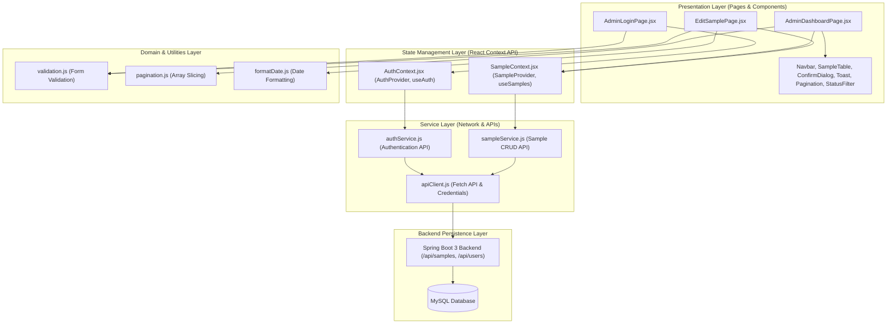
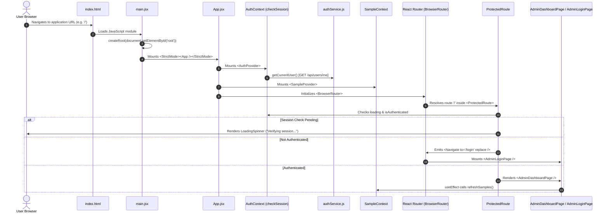
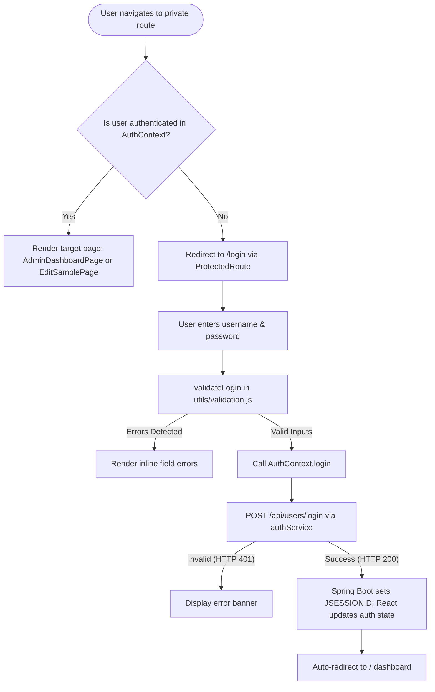
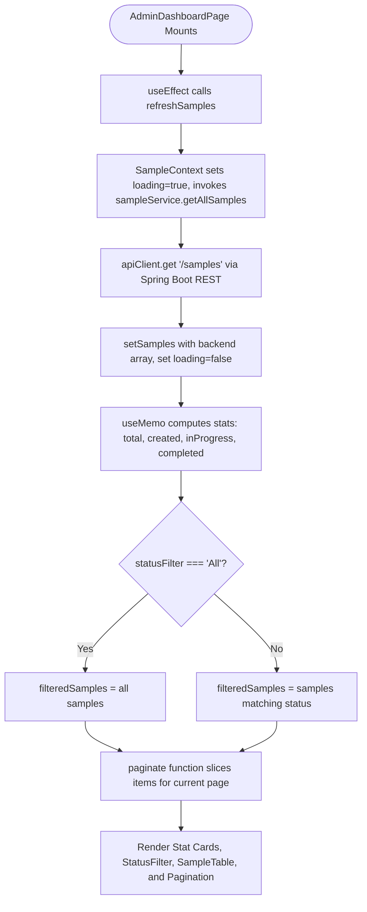
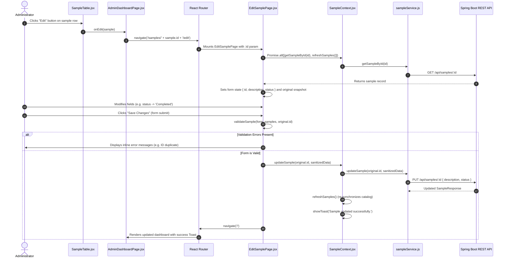
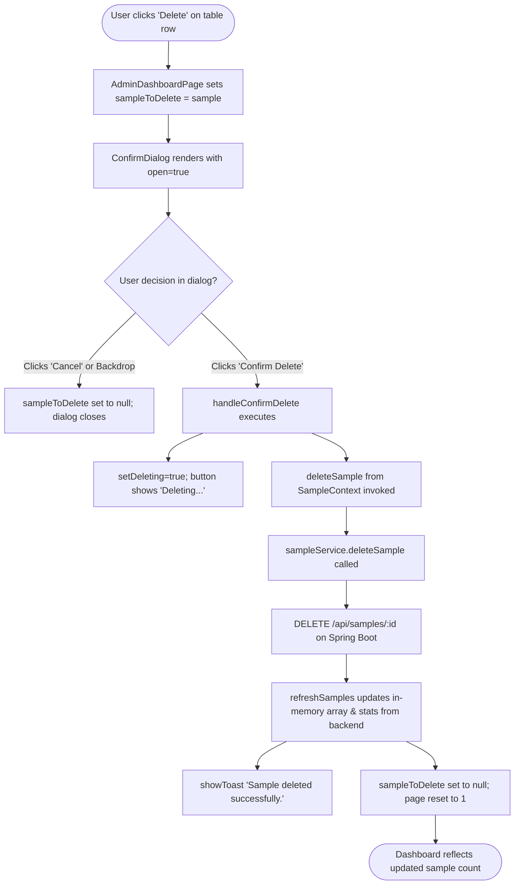
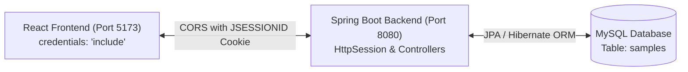

# Helix Lab Sample Management System: Comprehensive Codebase Guide

> A beginner-friendly, production-grade architectural and technical reference for understanding, navigating, debugging, and extending the Helix Lab Management application.

---

## 1. Project Overview

The **Helix Lab Sample Management System** is a modern, responsive web application engineered for clinical, academic, and industrial laboratory environments. It provides laboratory administrators with a centralized portal to oversee sample lifecycle pipelines, review sample requests, modify test parameters, inspect creator audit records, track real-time laboratory statistics, and safely remove decommissioned or invalid records.

### Key Capabilities
- **Sample Lifecycle Management**: Tracking sample progression across predefined laboratory milestones: `Created`, `In Progress`, and `Completed`.
- **Real-Time Statistical Metrics**: Computing aggregate counts of total, created, in-progress, and completed sample records from live backend data.
- **Backend-Only Data Persistence**: Communicating exclusively with a Spring Boot REST API and MySQL database for all persistent records and authentication.
- **Multi-Level Client Validation**: Enforcing strict positive integer constraints, cross-record ID uniqueness checks, character bounds, and domain status memberships.
- **Security & Session Management**: Safeguarding private routes via client-side route guards, authenticating administrator sessions via Spring Boot session cookies (`JSESSIONID`), and supporting cross-origin credentialed requests.
- **Accessible & Responsive Interface**: Built with Tailwind CSS v4 and Lucide React icons, adhering to WCAG accessibility principles (screen reader live regions, focus rings, reduced motion support, semantic HTML).

### Core Technology Stack
| Layer | Technologies |
| :--- | :--- |
| **Frontend Framework** | React 19 (Concurrent Mode, Functional Components, Custom Hooks) |
| **Routing** | React Router DOM v7 (Declarative BrowserRouter, Dynamic Route Parameters) |
| **Styling & Design System** | Tailwind CSS v4, Google Fonts (Fira Sans & Fira Code), CSS `@theme` variables |
| **Iconography** | Lucide React (FlaskConical, Pencil, Trash2, ChevronLeft, ChevronRight, CheckCircle2, CircleAlert, X) |
| **Build & Tooling** | Vite 8, Node.js v20 |
| **Backend Integration** | Spring Boot 3 REST API, Spring Data JPA, Hibernate, MySQL, HTTP Session (`JSESSIONID`) |

---

## 2. Complete Directory Structure

```
workspace/src/
├── App.jsx                     # Root application component; declares routes and context providers
├── main.jsx                    # Client bootstrapping entry point; mounts React 18 root into DOM
├── index.css                   # Global stylesheet with Tailwind CSS v4 imports, fonts, & theme tokens
│
├── config/                     # Application configuration constants
│   ├── adminConfig.js          # Branding name and visual constants
│   └── apiConfig.js            # API base URL, sample statuses, & page sizes
│
├── context/                    # Shared global state management via React Context API
│   ├── AuthContext.jsx         # Administrator authentication, backend session verification, login, & logout
│   └── SampleContext.jsx       # Sample records collection, metrics, CRUD handlers, & toast alerts
│
├── services/                   # Data access and network communication layer
│   ├── apiClient.js            # Standardized fetch HTTP client with header, cookie, & error handling
│   ├── authService.js          # Authentication service invoking Spring Boot session endpoints
│   └── sampleService.js        # Backend sample data access service invoking Spring Boot REST API
│
├── utils/                      # Reusable pure helper functions
│   ├── formatDate.js           # Formats raw dates into standardized 'MMM D, YYYY' strings
│   ├── pagination.js           # Calculates pagination indices, bounds, and array slices
│   └── validation.js           # Client-side validation rules for login and sample mutations
│
├── components/                 # Reusable presentational and controlled UI components
│   ├── ConfirmDialog.jsx       # Accessible modal dialog for destructive deletion confirmations
│   ├── LoadingSpinner.jsx      # Animated SVG/CSS spinner with accessible ARIA live status role
│   ├── Navbar.jsx              # Top header banner displaying logo, admin username, and logout
│   ├── Pagination.jsx          # Bottom pagination bar with Previous/Next buttons and page counts
│   ├── ProtectedRoute.jsx      # Route guard verifying backend authentication before rendering routes
│   ├── SampleTable.jsx         # Data grid presenting sample records with row-level Edit/Delete actions
│   ├── StatusBadge.jsx         # Color-coded pill badge representing sample lifecycle status
│   ├── StatusFilter.jsx        # Horizontal button group for filtering samples by status
│   └── Toast.jsx               # Floating toast alert with 3.5s auto-dismissal and success/error styling
│
├── pages/                      # Top-level route controller screens
│   ├── AdminDashboardPage.jsx  # Main view: statistics cards, status filters, and paginated table
│   ├── AdminLoginPage.jsx      # Administrator sign-in view with form validation and error handling
│   └── EditSamplePage.jsx      # Form view: edits sample ID, description, and status with audit info
│
└── docs/                       # Project documentation
    └── CODEBASE_GUIDE.md       # Comprehensive architecture and codebase guide (this document)
```

---

## 3. Architecture Overview

The application follows a clean, decoupled **Multi-Tiered Layered Architecture**. The presentation layer never communicates directly with low-level network primitives; instead, each layer has a distinct single responsibility.



### Architectural Principles Applied
1. **Separation of Concerns (SoC)**: UI components handle visual layout and user events; Context providers coordinate in-memory state; services handle backend persistence; utilities contain pure deterministic algorithms.
2. **Backend-Driven Architecture**: The frontend holds no local data persistence; all persistent records and authentication state are stored and managed by Spring Boot and MySQL.
3. **Controlled Components**: All forms maintain inputs in React state, providing instant validation feedback and predictable single sources of truth.
4. **Defensive Programming**: Functions check for missing, null, or corrupted inputs, returning safe fallbacks (e.g. `formatDate` returning `'—'`).

---

## 4. Application Startup Flow

When a user visits the application in a web browser, the startup lifecycle proceeds as follows:



---

## 5. Complete Authentication & Route Protection Flow

### Step-by-Step Breakdown
1. **Entry**: The user accesses `/login`. If already authenticated, `AdminLoginPage` immediately redirects to `/`.
2. **Form Input**: The user enters their credentials. React updates local `username` and `password` state on every keystroke.
3. **Client Validation**: The user clicks **Sign in**. `validateLogin()` checks that neither field is blank. If blank, inline error messages render.
4. **Authentication Check**: `login(username, password)` in `AuthContext.jsx` invokes `authService.login(username, password)` (HTTP POST `/api/users/login`).
5. **Backend Session**:
   - If credentials match: Spring Boot creates an `HttpSession` and sets an HttpOnly `JSESSIONID` session cookie.
   - In-memory React `auth` state is updated, triggering a re-render.
   - `AdminLoginPage` detects `isAuthenticated === true` and redirects to `/`.
6. **Route Protection**: When accessing private routes (`/` or `/samples/:id/edit`), `<ProtectedRoute>` verifies `isAuthenticated`. If false, it redirects to `/login` with `replace=true` to prevent browser history back-button loops.
7. **Logout**: Clicking **Logout** in `Navbar.jsx` executes `logout()`, calling `POST /api/users/logout` on the backend, invalidating the session, and resetting `auth` state.



---

## 6. Dashboard Data Loading & Interaction Flow

The `AdminDashboardPage.jsx` controls data presentation, filtering, pagination, and metric tracking:



### Dashboard UI States
- **Loading State**: Displays `<LoadingSpinner label="Loading samples..." />` while awaiting backend responses.
- **Error State**: Renders an accessible error message with a **Try again** retry button if a network or backend failure occurs.
- **Empty State**: Displays an informative notice if no sample records exist or if no samples match the active filter.
- **Data Grid State**: Renders `<SampleTable />` and `<Pagination />` when records are present.

---

## 7. Complete Edit Sample Flow

Editing allows administrators to update sample IDs, descriptions, and statuses while preserving creation metadata.



---

## 8. Complete Delete Sample Flow

To prevent accidental deletions of critical clinical data, sample deletion requires explicit modal confirmation:



---

## 9. Backend Integration Architecture

The frontend integrates cleanly with the **Spring Boot 3** REST backend:

### Network Communication & CORS
- **Base URL Configuration**: Evaluates `import.meta.env.VITE_API_BASE_URL` or defaults to `http://localhost:8080/api`.
- **CORS & Credentials**:
  - `apiClient.js` specifies `credentials: 'include'` on all `fetch` requests.
  - The Spring Boot backend's `CorsConfig.java` enables credentials:
    ```java
    registry.addMapping("/api/**")
            .allowedOrigins("http://localhost:5173")
            .allowedMethods("GET", "POST", "PUT", "DELETE")
            .allowedHeaders("*")
            .allowCredentials(true);
    ```
- **Session Authentication**:
  - The Spring Boot backend manages authenticated sessions using standard servlet `HttpSession`.
  - When a user logs in, Spring Boot attaches a session cookie (`JSESSIONID`) to the HTTP response headers.
  - The browser automatically stores and forwards this cookie on all subsequent requests because `credentials: 'include'` is set.



---

## 10. API Endpoint Reference

The following table documents every API endpoint available in the full-stack architecture:

| HTTP Verb | Endpoint Path | Frontend Caller | Payload Sent | Expected Response | Backend Controller Method | Purpose |
| :--- | :--- | :--- | :--- | :--- | :--- | :--- |
| `GET` | `/api/samples` | `sampleService.getAllSamples()` | None | `200 OK`<br/>`List<SampleResponse>` | `SampleController.getSamples()` | Retrieves all sample records from the backend. |
| `GET` | `/api/samples/{id}` | `sampleService.getSampleById(id)` | None | `200 OK`<br/>`SampleResponse` | `SampleController.getSampleById()` | Retrieves a single sample record by its unique identifier. |
| `PUT` | `/api/samples/{id}` | `sampleService.updateSample(id, data)` | JSON: `{ description, status }` | `200 OK`<br/>`SampleResponse` | `SampleController.updateSample()` | Updates description and status for the designated sample ID. |
| `DELETE` | `/api/samples/{id}` | `sampleService.deleteSample(id)` | None | `200 OK`<br/>`"Sample deleted successfully"` | `SampleController.deleteSample()` | Deletes the specified sample record from the database. |
| `POST` | `/api/users/login` | `authService.login()` | JSON: `{ email, password }` | `200 OK`<br/>`LoginResponse` | `UserController.loginUser()` | Authenticates user; binds `userId` to `HttpSession`. |
| `GET` | `/api/users/me` | `authService.getCurrentUser()` | None | `200 OK`<br/>`{ userId, username }` | `UserController.getCurrentUser()` | Returns the user profile for the current active HTTP session. |
| `POST` | `/api/users/logout` | `authService.logout()` | None | `200 OK`<br/>`"Logout successful"` | `UserController.logout()` | Invalidates the current `HttpSession`. |
| `GET` | `/api/health` | *(System monitoring)* | None | `200 OK`<br/>`{ status: "UP" }` | `HealthController.getHealth()` | Verifies that the Spring Boot application is healthy. |

---

## 11. Context API Explanation

The application employs React's native **Context API** for global state management:

### 1. `AuthContext.jsx`
- **State Provided**:
  - `isAuthenticated` (boolean): Whether an administrator session is verified.
  - `username` (string | null): Active administrator's username.
  - `loading` (boolean): Whether session verification is pending.
- **Actions Provided**:
  - `login(username, password)`: Asynchronous credential verification via Spring Boot.
  - `logout()`: Terminates session on the backend and resets state to unauthenticated.
- **Custom Hook**: `useAuth()` simplifies consumer access and asserts that the consumer is rendered inside an `<AuthProvider>`.

### 2. `SampleContext.jsx`
- **State Provided**:
  - `samples` (Array): Primary collection of laboratory sample records from the backend.
  - `loading` (boolean): Asynchronous fetch status indicator.
  - `error` (string | null): Network/server error message.
  - `toast` (Object | null): Active notification banner `{ message, type, id }`.
  - `stats` (Object): Aggregate metrics `{ total, created, inProgress, completed }`.
- **Actions Provided**:
  - `refreshSamples()`: Asynchronously fetches all samples from backend and updates state.
  - `getSampleById(id)`: Looks up a specific sample from backend.
  - `updateSample(id, data)`: Modifies a sample on backend, triggers list refresh, and shows success toast.
  - `deleteSample(id)`: Deletes a sample on backend, triggers list refresh, and shows success toast.
  - `showToast(message, type)`: Displays custom notification.
  - `clearToast()`: Dismisses notification.
- **Custom Hook**: `useSamples()` provides access and boundary assertion.

---

## 12. Service Layer

The application organizes data access into focused service modules in `src/services/`:

```
               ┌───────────────────────┐
               │   SampleContext.jsx   │
               └───────────┬───────────┘
                           │ calls unified methods
               ┌───────────▼───────────┐
               │   sampleService.js    │
               └───────────┬───────────┘
                           │ delegates calls to
               ┌───────────▼───────────┐
               │     apiClient.js      │
               └───────────┬───────────┘
                           │ HTTP fetch (credentials: include)
                           ▼
               ┌───────────────────────┐
               │   Spring Boot API     │
               └───────────────────────┘
```

1. **Zero Client Storage**: No application data is stored in the browser.
2. **Standardized Error Handling**: `apiClient.js` normalizes HTTP errors and extracts backend messages from `GlobalExceptionHandler`.

---

## 13. Component Dependency Overview

```
App
├── AuthProvider (context/AuthContext.jsx)
└── SampleProvider (context/SampleContext.jsx)
    └── BrowserRouter (react-router-dom)
        └── Routes
            ├── Route: "/login"
            │   └── AdminLoginPage (pages/AdminLoginPage.jsx)
            │
            ├── Route: "/" (wrapped in ProtectedRoute)
            │   └── ProtectedRoute (components/ProtectedRoute.jsx)
            │       └── AdminDashboardPage (pages/AdminDashboardPage.jsx)
            │           ├── Navbar (components/Navbar.jsx)
            │           ├── Toast (components/Toast.jsx)
            │           ├── StatusFilter (components/StatusFilter.jsx)
            │           ├── LoadingSpinner (components/LoadingSpinner.jsx)
            │           ├── SampleTable (components/SampleTable.jsx)
            │           │   └── StatusBadge (components/StatusBadge.jsx)
            │           ├── Pagination (components/Pagination.jsx)
            │           └── ConfirmDialog (components/ConfirmDialog.jsx)
            │
            └── Route: "/samples/:id/edit" (wrapped in ProtectedRoute)
                └── ProtectedRoute (components/ProtectedRoute.jsx)
                    └── EditSamplePage (pages/EditSamplePage.jsx)
                        ├── Navbar (components/Navbar.jsx)
                        ├── Toast (components/Toast.jsx)
                        └── LoadingSpinner (components/LoadingSpinner.jsx)
```

---

## 14. Important React Hooks Used in the Project

| Hook Name | Usage Location | Purpose in the Codebase |
| :--- | :--- | :--- |
| `useState` | All Pages & Contexts | Tracks local mutable state (`form`, `statusFilter`, `page`, `sampleToDelete`, `auth`, `samples`). |
| `useEffect` | `AdminDashboardPage.jsx`<br/>`EditSamplePage.jsx`<br/>`AuthContext.jsx`<br/>`Toast.jsx` | Coordinates side effects: verifying session on startup, loading samples on mount, fetching records by route ID, and setting auto-dismiss timers. |
| `useCallback` | `SampleContext.jsx`<br/>`AuthContext.jsx` | Memoizes CRUD and auth functions (`refreshSamples`, `updateSample`, `deleteSample`, `login`, `logout`) so their references stay stable in dependency arrays. |
| `useMemo` | `SampleContext.jsx`<br/>`AuthContext.jsx`<br/>`AdminDashboardPage.jsx` | Memoizes calculated values: `stats` aggregation, `filteredSamples` filtering, and `pagination` calculations. |
| `useContext` | `useAuth()`<br/>`useSamples()` | Consumes shared context state in descendant components with built-in null-check assertions. |
| `useParams` | `EditSamplePage.jsx` | Extracts dynamic route parameters from the URL (e.g. extracts `101` from `/samples/101/edit`). |
| `useNavigate` | `AdminDashboardPage.jsx`<br/>`EditSamplePage.jsx` | Provides programmatic imperative navigation (e.g. `navigate('/')` or `navigate('/samples/101/edit')`). |

---

## 15. Error Handling Strategy

1. **Inline Field Errors**: Forms display field-specific error messages directly beneath the invalid input elements.
2. **Alert Banners**: High-level authentication failures display alert banners with accessible `role="alert"` attributes.
3. **HTTP Status Code Normalization**: In `apiClient.js`, HTTP errors (4xx, 5xx) extract backend messages from Spring Boot's error payloads and attach the numeric HTTP status to the thrown Error instance.
4. **Graceful Fallbacks**:
   - `formatDate` returns `'—'` for null values and raw strings for invalid timestamps.
5. **Toast Error Alerts**: Operations failing in background calls trigger `showToast(errorMessage, 'error')`.

---

## 16. Configuration & Environment Variables

| Variable / Constant | File Location | Default Value | Description |
| :--- | :--- | :--- | :--- |
| `VITE_API_BASE_URL` | Environment / `apiConfig.js` | `http://localhost:8080/api` | Base URL endpoint for Spring Boot REST API calls. |
| `PAGE_SIZE` | `config/apiConfig.js` | `10` | Standard number of sample records displayed per page. |
| `SAMPLE_STATUSES` | `config/apiConfig.js` | `['Created', 'In Progress', 'Completed']` | Canonical domain lifecycle statuses. |
| `APP_NAME` | `config/adminConfig.js` | `'Helix Lab Sample Management'` | Application branding title string. |

---

## 17. Feature-to-File Mapping

| Feature | Starting File | Context | Service Layer | Utility / Helper | Final Destination |
| :--- | :--- | :--- | :--- | :--- | :--- |
| **Admin Sign In** | `pages/AdminLoginPage.jsx` | `context/AuthContext.jsx` (`login`) | `services/authService.js` (`login`) | `utils/validation.js` (`validateLogin`) | Backend session & navigation to `/` |
| **Admin Sign Out** | `components/Navbar.jsx` | `context/AuthContext.jsx` (`logout`) | `services/authService.js` (`logout`) | None | Session invalidated & redirection to `/login` |
| **Route Protection**| `components/ProtectedRoute.jsx` | `context/AuthContext.jsx` (`isAuthenticated`, `loading`) | `services/authService.js` (`getCurrentUser`) | None | Renders children or redirects to `/login` |
| **Dashboard Loading**| `pages/AdminDashboardPage.jsx` | `context/SampleContext.jsx` (`refreshSamples`) | `services/sampleService.js` (`getAllSamples`) | None | `SampleTable.jsx` rendering data rows |
| **Status Filtering** | `components/StatusFilter.jsx` | `pages/AdminDashboardPage.jsx` (`statusFilter`) | None | `utils/pagination.js` (`paginate`) | Re-rendered `SampleTable.jsx` |
| **Table Pagination** | `components/Pagination.jsx` | `pages/AdminDashboardPage.jsx` (`page`) | None | `utils/pagination.js` (`paginate`) | Updated page slice in `SampleTable.jsx` |
| **Sample Editing** | `pages/EditSamplePage.jsx` | `context/SampleContext.jsx` (`updateSample`) | `services/sampleService.js` (`updateSample`) | `utils/validation.js` (`validateSample`) | `PUT /api/samples/{id}` on Spring Boot |
| **Sample Deletion** | `components/ConfirmDialog.jsx` | `context/SampleContext.jsx` (`deleteSample`) | `services/sampleService.js` (`deleteSample`) | None | `DELETE /api/samples/{id}` on Spring Boot |
| **Toast Alerts** | `context/SampleContext.jsx` | `context/SampleContext.jsx` (`showToast`) | None | None | `components/Toast.jsx` floating banner |
